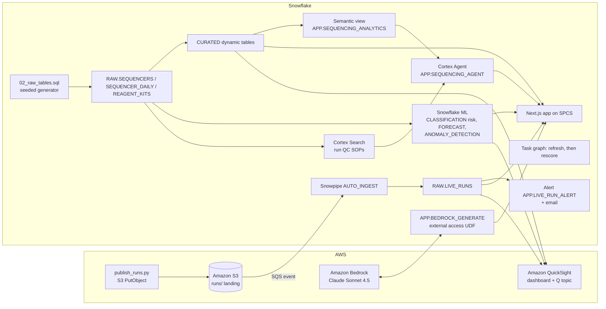

# Singapore Genomic Sequencing Lab Operations

End-to-end sequencing operations analytics for **Harbourline Genomics**, a fictional Singapore research sequencing network with **40 sequencers across 8 lab sites** (Queenstown, Novena, Outram, Jurong East, Tampines, Woodlands, Seletar and Changi) and 5 assay lines, using Snowflake, optionally with AWS: from a live run-completion summary to a 7-day failed-run risk score, a run QC flag email and an AI action memo for the head of sequencing operations. All data is synthetic and aggregate per instrument and day: there are no patient, sample-level or genomic records, and nothing here is for clinical or diagnostic use.

## Architecture

A sequencing operations pipeline built on **Snowflake** (Dynamic Tables, Snowflake ML, Cortex Search, Cortex Agent, Cortex AI_COMPLETE, SPCS) and, in the full build, **AWS** (Amazon S3, Bedrock Claude, QuickSight + Amazon Q). Run summaries land in `RAW.LIVE_RUNS`. Dynamic tables curate 90 days of instrument-day history: samples sequenced, data output against target (yield attainment), run QC flags, confirmed failed runs, re-queued runs and preventive maintenance (PM) compliance. Snowflake ML scores 7-day failed-run risk per sequencer, forecasts network-wide sample volume and flags phasing anomalies. A Cortex Agent answers questions with SOP citations, and an LLM drafts the operations action memo.

Interactive diagrams (hover for object names): [Snowflake only](docs/architecture-snowflake.html) | [AWS + Snowflake](docs/architecture-aws.html). The app shows both on its Architecture & Data tab, the current build first. Regenerate them with `python3 docs/build_architecture.py`.



The Snowflake-only build drops the AWS subgraph: `APP.SIMULATE_RUNS` writes to `RAW.LIVE_RUNS`, and the app calls Cortex `AI_COMPLETE` instead of the Bedrock UDF.

## Snowflake Capabilities

| Capability | Implementation |
|-----------|---------------|
| Dynamic Tables | `CURATED.KPI_SUMMARY`, `PERFORMANCE_SUMMARY`, `FAILURE_MODE_SUMMARY`, `TREND_ANALYSIS` from the RAW tables |
| Snowflake ML | CLASSIFICATION 7-day failed-run risk (`ML.QC_FAIL_SCORES`), 14-day sample volume FORECAST, phasing ANOMALY_DETECTION |
| Cortex Search | 13 synthetic run QC troubleshooting SOPs (one per assay and failure mode) in `SEARCH.QC_SOP_SEARCH` |
| Semantic View | `APP.SEQUENCING_ANALYTICS` over sequencers, failure modes, daily totals and risk |
| Cortex Agent | `APP.SEQUENCING_AGENT`: Cortex Analyst over the semantic view plus Cortex Search for SOP citations |
| Cortex AI | `AI_COMPLETE('claude-sonnet-4-5')` for grounded answers, and for the action memo in the Snowflake-only build |
| Alerts + Tasks | `APP.LIVE_RUN_ALERT` logs QC_FLAG events and sends email; task graph `TASK_REFRESH_CURATED`, then `TASK_RESCORE_RISK` |
| Snowpark Container Services | Next.js app `APP.SG_HEALTHCARE_GENOMICS_APP` with 6 tabs: Executive Cockpit, Predictive, Lab Readiness, Live Runs, Ask AI, Architecture & Data |
| Snowpipe | `RAW.LIVE_RUNS_PIPE` AUTO_INGEST from S3 (AWS build only) |

## AWS Services

Used only in the AWS + Snowflake build.

| Service | Role in Demo |
|---------|-------------|
| Amazon S3 | Landing bucket (`runs/`): `aws/publish_runs.py` uploads sequencer run-completion summaries as newline-delimited JSON. An event notification goes to the Snowpipe SQS queue |
| Amazon Bedrock | Claude Sonnet 4.5 writes the action memo, called from Snowflake through an external-access UDF |
| Amazon QuickSight | DIRECT_QUERY executive dashboard over Snowflake (daily samples and QC flags, confirmed failed runs by sequencer, failed-run risk) |
| Amazon Q | Natural-language questions over the QuickSight topic `sg-healthcare-genomics-topic` |
| AWS IAM | Least-privilege role for Snowflake S3 reads and a Bedrock-only invoke user |

## Personas

These personas are fictional.

| Persona | Role | Key Questions |
|---------|------|---------------|
| **Dr Shalini Menon** | Head of Sequencing Operations, Harbourline Genomics | "What is our yield attainment by assay?" "Which failure modes produce the most confirmed failed runs?" |
| **Marcus Teo** | Lab QC Scientist, Novena site | "Which sequencers are high risk this week, and which SOP applies?" |

## Data

All data is synthetic and seeded, so every rebuild reproduces it. Harbourline Genomics, its sequencers and all names are fictional; the sites are real Singapore planning areas. Every table is aggregate per instrument (and day); there are no patient, sample-level, variant or other genomic records.

| Table | Rows | Description |
|-------|------|-------------|
| RAW.SEQUENCERS | 40 | Sequencers: every combination of 8 lab sites and 5 assay lines (Whole Genome, Whole Exome, Targeted Panel, RNA-Seq, Pathogen Surveillance), with utilisation tier, instrument age and daily target output |
| RAW.SEQUENCER_DAILY | 3,600 | Daily instrument observations over 90 days: samples sequenced, data output and target (GB), run QC flags, confirmed failed runs, re-queued runs, failure mode, PM visits, phasing and low-Q30 tile share. Includes two site-wide reagent lot holds (Novena, Seletar) |
| RAW.REAGENT_KITS | 40 | Required, on-hand and on-order reagent kits per sequencer |
| SEARCH.QC_SOP_DOCS | 13 | Synthetic run QC troubleshooting SOPs indexed for Cortex Search |
| RAW.LIVE_RUNS | Grows during the demo | Live run summaries from S3 (AWS build) or `APP.SIMULATE_RUNS` (Snowflake-only build) |
| ML.QC_FAIL_SCORES | 40 | 7-day failed-run probability and risk band per sequencer |

## Build Instructions

### Prerequisites
- Snowflake account with ACCOUNTADMIN access, and Cortex AI enabled (AI_COMPLETE, Search, Agent).
- An X-Small warehouse with auto-suspend at or below 120 s, and an existing SPCS compute pool.
- Python 3.11+, `snowflake-connector-python`, Node.js 22+, Docker and the `snow` CLI.
- App image: create the `APP.IMAGES` repository, run `snow spcs image-registry login`, then build (`--platform linux/amd64`) and push `sg-healthcare-genomics-app:v1` (see the header of `snowflake/07_deploy_app.sql`).
- AWS build only: `boto3`, AWS credentials for the target account (us-west-2) with Bedrock access, and QuickSight Enterprise.

### SPCS App
```
<DATABASE>.APP.SG_HEALTHCARE_GENOMICS_APP
```

### Tests
```bash
python -m pytest aws snowflake quicksight
```

For a local run, put `SNOWFLAKE_ACCOUNT`, `SNOWFLAKE_USER`, `SNOWFLAKE_DATABASE`, `SNOWFLAKE_WAREHOUSE`, `SNOWFLAKE_AUTHENTICATOR=PROGRAMMATIC_ACCESS_TOKEN`, `SNOWFLAKE_TOKEN` and `DEMO_PLATFORM` in the environment, then run `npm --prefix app run build && npm --prefix app start`.

## Build Modes

Both modes share the same core. They differ in three places, and the app's `DEMO_PLATFORM` setting (in its SPCS spec) switches the memo provider and the Live Runs tab.

| Layer | Snowflake Only | Full AWS + Snowflake |
|---|---|---|
| Live runs | `CALL APP.SIMULATE_RUNS(n)` inserts simulated run-completion summaries into `RAW.LIVE_RUNS`. This simulates a sequencer run-summary feed; it is not Snowpipe Streaming | `aws/publish_runs.py` uploads run-summary batches to S3, then SQS and Snowpipe AUTO_INGEST |
| Action memo | Cortex `AI_COMPLETE('claude-sonnet-4-5')` | Amazon Bedrock Claude Sonnet 4.5 through `APP.BEDROCK_GENERATE` |
| BI and natural-language questions | The SPCS app is the dashboard; questions go to the Cortex Agent | Also a QuickSight dashboard and an Amazon Q topic |
| App setting | `DEMO_PLATFORM: snowflake` | `DEMO_PLATFORM: aws` |

### Snowflake Only

```bash
# 1. Core data and dynamic tables (guarded: new isolated database only)
python snowflake/run_core.py --database SINGAPORE_HEALTHCARE_GENOMICS_SNOWFLAKE --warehouse <XS_WAREHOUSE> --connection <CONNECTION> --apply
# 2. Native run feed, ML, search, semantic view, agent, alert and task graph
python snowflake/run_intelligence.py --database SINGAPORE_HEALTHCARE_GENOMICS_SNOWFLAKE --platform snowflake --warehouse <XS_WAREHOUSE> --connection <CONNECTION> --alert-email you@example.com
# 3. App on SPCS with DEMO_PLATFORM=snowflake (push the image first)
python snowflake/run_intelligence.py --database SINGAPORE_HEALTHCARE_GENOMICS_SNOWFLAKE --platform snowflake --warehouse <XS_WAREHOUSE> --connection <CONNECTION> --alert-email you@example.com --files 07_deploy_app.sql --compute-pool <COMPUTE_POOL>
```

During the demo:
- Run `CALL APP.SIMULATE_RUNS(20)` to add live run summaries. For a continuous feed, run `ALTER TASK APP.TASK_SIMULATE_RUNS RESUME`, and `SUSPEND` it afterwards.
- Run `EXECUTE ALERT APP.LIVE_RUN_ALERT` to raise the run QC flag email.
- Run `EXECUTE TASK APP.TASK_REFRESH_CURATED` to refresh the curated tables and rescore risk.

Afterwards, drop the database or run `ALTER SERVICE APP.SG_HEALTHCARE_GENOMICS_APP SUSPEND`.

### Full AWS + Snowflake

```bash
# 1. Core data and dynamic tables (guarded: new isolated database only)
python snowflake/run_core.py --database SINGAPORE_HEALTHCARE_GENOMICS_AWS --warehouse <XS_WAREHOUSE> --connection <CONNECTION> --apply
# 2. AWS ingestion and Bedrock (dry run first, then --apply)
python aws/setup_aws.py --database SINGAPORE_HEALTHCARE_GENOMICS_AWS --account <AWS_ACCOUNT_ID> --connection <CONNECTION> --apply
# 3. ML, search, semantic view, agent, alert and task graph
python snowflake/run_intelligence.py --database SINGAPORE_HEALTHCARE_GENOMICS_AWS --platform aws --warehouse <XS_WAREHOUSE> --connection <CONNECTION> --alert-email you@example.com
# 4. App on SPCS with DEMO_PLATFORM=aws (push the image first)
python snowflake/run_intelligence.py --database SINGAPORE_HEALTHCARE_GENOMICS_AWS --platform aws --warehouse <XS_WAREHOUSE> --connection <CONNECTION> --alert-email you@example.com --files 07_deploy_app.sql --compute-pool <COMPUTE_POOL>
# 5. QuickSight dashboard and Q topic (needs an existing Snowflake data source)
python quicksight/build_dashboards.py --database SINGAPORE_HEALTHCARE_GENOMICS_AWS --account <AWS_ACCOUNT_ID> --principal-arn <QUICKSIGHT_USER_ARN> --data-source-arn <DATA_SOURCE_ARN> --prefix sg-healthcare-genomics --apply --update --with-topic
```

QuickSight objects must be shared with the QuickSight user who signs in (`--principal-arn`); otherwise the console shows nothing.

During the demo:
- Run `python aws/publish_runs.py --account <AWS_ACCOUNT_ID> --count 20` to upload a batch of live run summaries. Snowpipe loads it within about a minute.
- Run `EXECUTE ALERT APP.LIVE_RUN_ALERT` to raise the run QC flag email.
- Run `EXECUTE TASK APP.TASK_REFRESH_CURATED` to refresh the curated tables and rescore risk.

Afterwards, `python aws/teardown_aws.py --database SINGAPORE_HEALTHCARE_GENOMICS_AWS --account <AWS_ACCOUNT_ID> --connection <CONNECTION> --apply` removes the AWS resources and the account-level Bedrock external-access and S3 storage integrations. It leaves the email integration `SG_HEALTHCARE_GENOMICS_EMAIL_INT`, which the Snowflake-only build also uses.

## Business Impact

Industry and national context, and a Snowflake customer outcome:
- **Singapore sequencing at national scale**: "NPM Phase II sequenced 100,000 Singaporeans and conducted clinical implementation studies, linking genomic, lifestyle, and healthcare data to deepen understanding of Asian diseases." -- [PRECISE, Singapore's National Precision Medicine Programme](https://www.npm.sg/about-us/singapore-s-national-precision-medicine-programme/)
- **Sequencing cost**: "the cost to generate a high-quality 'draft' whole human genome sequence in mid-2015 was just above $4,000; by late in 2015, that figure had fallen below $1,500" -- [NHGRI, The Cost of Sequencing a Human Genome](https://www.genome.gov/about-genomics/fact-sheets/Sequencing-Human-Genome-cost)
- **Ginkgo Bioworks** (Snowflake customer): "5 minutes to identify experiment issues, instead of days", and its "data volumes have grown exponentially — increasing by about 10x every three years" -- [Snowflake customer story: Ginkgo Bioworks](https://www.snowflake.com/en/customers/all-customers/case-study/ginkgo-bioworks/)

## Key Demo Numbers

These figures are synthetic and come from the seeded demo data. Forecast and anomaly figures can shift slightly with the build day.

- **40 sequencers** (8 Singapore lab sites x 5 assays), 3,600 instrument-days over 90 days: **203,279 samples sequenced** and 2,499.9 TB of data output, so **yield attainment is 94.8%** of target. By assay, Targeted Panel runs highest (96.1%) and RNA-Seq lowest (94.0%); by site, Woodlands leads (96.8%) and Novena trails (89.5%, including its reagent lot hold day). The weakest sequencer is SQ-0001 Novena Whole Genome at 88.7%
- **711 run QC flags** and **224 confirmed failed runs**, so QC flag precision is 31.5%; **114** failed runs re-queued
- **Low cluster density** produces the most confirmed failed runs (37 of 72 flags); the 10 reagent lot hold flags (Novena and Seletar hold days) are never confirmed
- **Failed-run risk model** out-of-time holdout: precision 0.41, recall 0.35 at a 0.5 threshold, against a 0.25 base rate. Nine sequencers are high risk; the top one is SQ-0031 Changi RNA-Seq, at 94.5%
- **14-day sample volume forecast** with prediction intervals; **26 of 640** instrument-days flagged as phasing anomalies
- **PM compliance 79.1%**, reagent kit coverage 65.3%, with 20 kits on order
- **13 SOPs** indexed for Cortex Search and cited by ID in agent answers

## License

Apache 2.0 — See [LICENSE](LICENSE) for details.

This is a personal demo project and is not an official Snowflake offering. It comes with no support or warranty. It uses synthetic, aggregate operations data only and is not intended for clinical, diagnostic or medical use. Industry metrics cited are from publicly available third-party research and Snowflake customer stories; they represent reported outcomes and are not guarantees of results.
